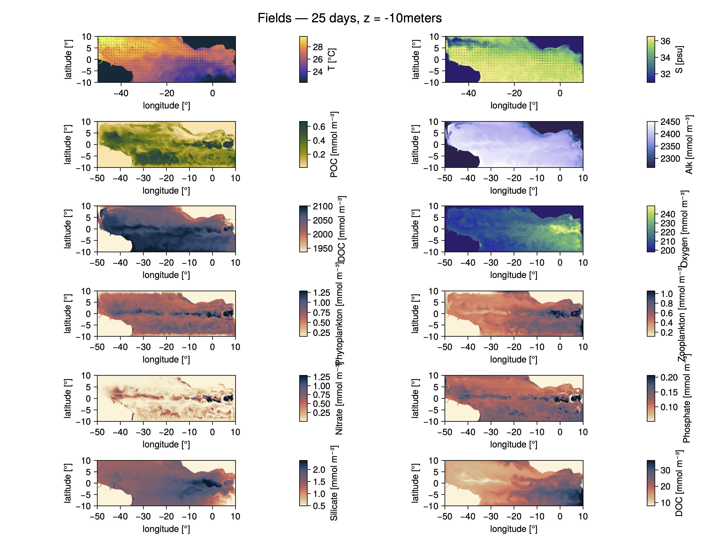

# LifeRomancheFractureZone

A model of the Atlantic ocean designed during the Schmidt Ocean Instute 'Life at the Mid-Atlantic Ridge fracture zone' research cruise. Part of an effort to better understand the life in the Romanche Fracture Zone. 

Model based on the NumericalEarth.jl framework (cheers to the NumericalEarth team for putting together such an amazing tool!). 

Two models are archived here: 
* Ocean model evolving temperature, salinity forced by GLORYS at the North, South, East, and West boundaries. Coupled to a JRA55 atmosphere. Includes M2 tides. 1/12 of a degree horizontal resolution, 62 vertical levels. 
* Biogeochemical model forced by GLORYS at the North, South, East, and West boundaries for temperature and salinity and ECCO-Darwin for the biogeochemical fields. Coupled to a JRA55 atmosphere. 1/6 of a degree horizontal resolution, 62 vertical levels. 
The biogeochemistry evolves two populations of phyto- and zooplanktons, their nutrients and detritus, carbon and oxygen chemistry.  

Runs on a GPU: a few hours are needed to get a few months of simulations. 

## Dependencies
Julia 1.12

## Authors
Nicolaos Petropoulos

## Acknowledgments
* [NumericalEarth](https://github.com/NumericalEarth)
* [Oceananigans](https://clima.github.io/OceananigansDocumentation/stable/)
* [OceanBioME](https://oceanbiome.github.io/OceanBioME.jl/stable/)
